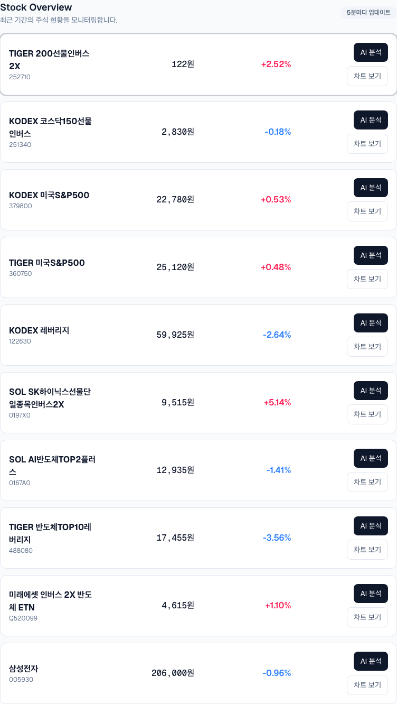
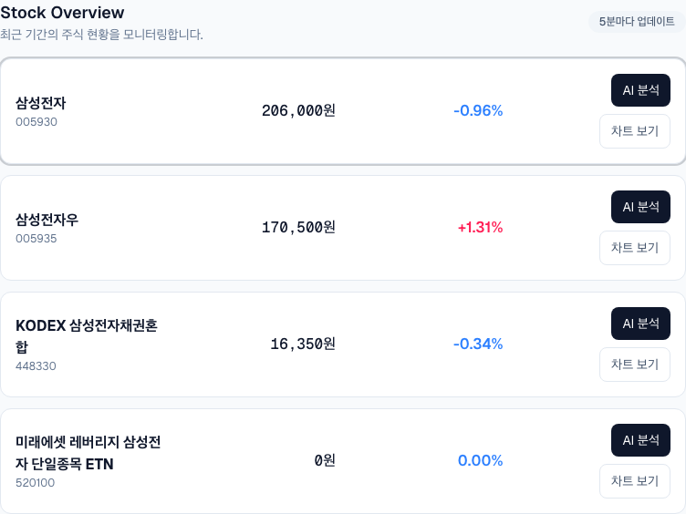
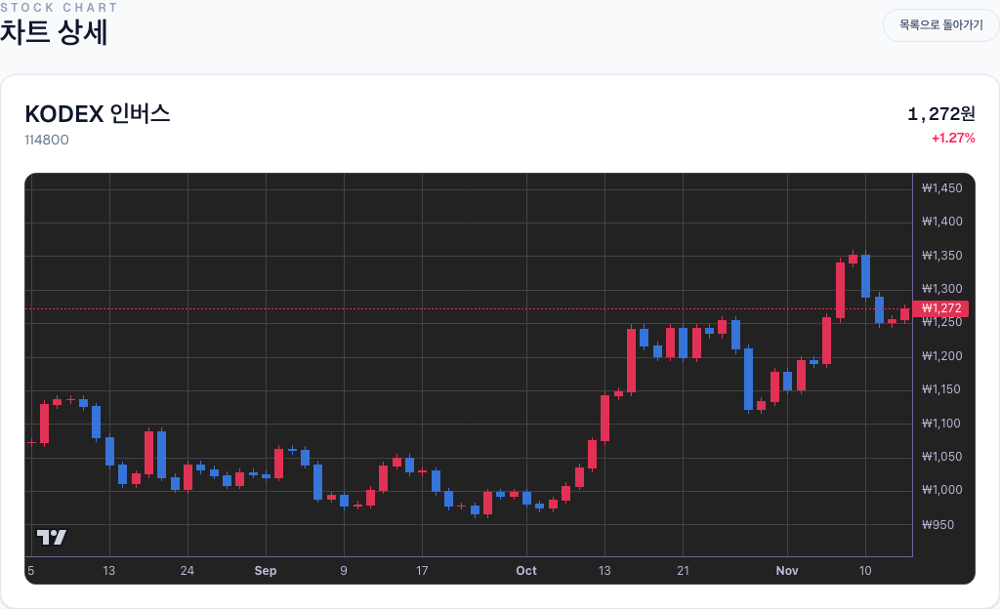

```json
{
  "schemaVersion": 1,
  "slug": "stock-ai-platform",
  "title": "주식 분석 플랫폼",
  "description": "국내·해외 주식 시세와 가격 이력, 종목 검색, 뉴스 기반 분석을 하나의 탐색 흐름으로 연결한 Next.js 대시보드입니다. KIS 시세 조회와 Groq 분석 요청을 서버에서 처리하고, 종목별 차트와 추천 근거를 함께 확인하도록 구성했습니다.",
  "stacks": [
    "Next.js",
    "React.js",
    "TypeScript",
    "TailwindCSS",
    "supabase"
  ],
  "linkDemo": "https://stock.ycseng.com",
  "linkGithub": "https://github.com/side-projects-labs/stock-ai-platform"
}
```

# 주식 분석 플랫폼

## 목차

- [🧭 숫자에서 맥락으로 이어지는 탐색](#-%EC%88%AB%EC%9E%90%EC%97%90%EC%84%9C-%EB%A7%A5%EB%9D%BD%EC%9C%BC%EB%A1%9C-%EC%9D%B4%EC%96%B4%EC%A7%80%EB%8A%94-%ED%83%90%EC%83%89)
- [🗂️ 시장 목록에서 관심 종목까지](#%EF%B8%8F-%EC%8B%9C%EC%9E%A5-%EB%AA%A9%EB%A1%9D%EC%97%90%EC%84%9C-%EA%B4%80%EC%8B%AC-%EC%A2%85%EB%AA%A9%EA%B9%8C%EC%A7%80)
- [📈 가격 이력을 읽는 상세 차트](#-%EA%B0%80%EA%B2%A9-%EC%9D%B4%EB%A0%A5%EC%9D%84-%EC%9D%BD%EB%8A%94-%EC%83%81%EC%84%B8-%EC%B0%A8%ED%8A%B8)
- [📰 가격과 뉴스를 분석으로 연결하기](#-%EA%B0%80%EA%B2%A9%EA%B3%BC-%EB%89%B4%EC%8A%A4%EB%A5%BC-%EB%B6%84%EC%84%9D%EC%9C%BC%EB%A1%9C-%EC%97%B0%EA%B2%B0%ED%95%98%EA%B8%B0)
- [🛠️ 외부 서비스와 화면의 경계 나누기](#%EF%B8%8F-%EC%99%B8%EB%B6%80-%EC%84%9C%EB%B9%84%EC%8A%A4%EC%99%80-%ED%99%94%EB%A9%B4%EC%9D%98-%EA%B2%BD%EA%B3%84-%EB%82%98%EB%88%84%EA%B8%B0)
- [🌱 검증하며 확장할 탐색 흐름](#-%EA%B2%80%EC%A6%9D%ED%95%98%EB%A9%B0-%ED%99%95%EC%9E%A5%ED%95%A0-%ED%83%90%EC%83%89-%ED%9D%90%EB%A6%84)

주식 데이터를 살펴볼 때 가격과 등락률만으로는 종목을 이해하기 어렵습니다. 최근 흐름이 어땠는지, 어떤 뉴스가 있었는지, 관심을 둘 만한 근거와 주의할 점은 무엇인지도 함께 확인해야 합니다. 이 프로젝트는 시세 목록에서 시작해 종목 검색, 가격 차트, 분석 내용을 이어서 살펴볼 수 있는 웹 대시보드로 구성했습니다.

## 🧭 숫자에서 맥락으로 이어지는 탐색

국내·해외 시장의 데이터를 같은 화면 구성으로 다루되, 종목을 찾는 방법은 나눴습니다. 시장에서 거래가 활발한 종목은 순위 목록에서 살펴보고, 이미 관심 있는 종목은 이름이나 티커로 검색합니다. 각 목록에서는 가격·등락률을 비교하고, 관심 종목의 차트와 분석으로 이동할 수 있습니다.

구현의 중심은 외부 데이터를 화면에 표시하는 흐름을 연결하는 데 있습니다. 시세 조회와 뉴스 수집, 모델 호출을 각각 서버에서 처리하고, 화면은 그 결과를 공통 종목 데이터로 받아 사용합니다. 가격 변화와 분석 문장을 함께 살펴보되, 관측한 시세와 해석된 정보를 구분할 수 있도록 역할을 나눴습니다.

## 🗂️ 시장 목록에서 관심 종목까지

### 거래가 활발한 종목을 살펴보기

기본 진입 화면은 국내 주식 목록이며, 탭을 통해 해외 시장으로 이동할 수 있습니다. 국내 시장에서는 거래량과 거래대금 기준을 선택합니다. 목록에는 종목명·코드·현재 가격·등락률을 표시하고, 개별 종목에 분석 요청과 차트 이동 버튼을 배치했습니다.



*실제 배포 서비스에서 종목 목록 영역을 캡처했습니다. 같은 행에서 가격·등락률을 비교하고 상세 화면으로 이동할 수 있습니다. 화면에 보이는 수치는 촬영 시점의 조회 결과입니다.*

시세 목록은 React Query로 조회하며 5분마다 갱신하도록 구성했습니다. 조회 키에는 시장과 순위 기준을 포함해 국내·해외 데이터나 정렬 조건이 다른 결과가 같은 캐시를 사용하지 않도록 했습니다. 화면에서 외부 증권 API를 직접 호출하지 않고 Next.js의 내부 API를 거치므로 인증 정보와 시세 처리 로직은 서버에 남습니다.

### 이름과 티커로 탐색 범위 좁히기

검색은 별도 페이지에서 처리합니다. 입력한 검색어를 URL에 담아 조회하고, 결과에서도 기존 종목 목록 컴포넌트를 재사용합니다. 순위 목록에 나오지 않는 종목을 찾더라도 가격 확인과 차트 이동 방식은 유지합니다.



*실제 검색 결과의 목록 영역입니다. 종목명과 코드를 함께 표시해 이름이 비슷한 종목을 구분합니다.*

국내 종목 검색에서는 KOSPI·KOSDAQ·KONEX 종목 마스터를 내려받아 압축을 해제하고 인코딩을 변환해 이름과 코드를 읽습니다. 마스터 데이터는 일정 시간 캐시해 매번 전체 파일을 다시 내려받지 않도록 했습니다. 검색 조건과 시세 조회를 서버 서비스에 모으고, 화면은 검색 결과를 공통 종목 타입으로 전달받습니다.

## 📈 가격 이력을 읽는 상세 차트

목록에서 차트 보기를 선택하면 종목별 상세 페이지로 이동합니다. 상세 화면은 주소의 종목 식별자로 데이터를 다시 조회하며 종목명·가격·등락률과 차트를 함께 보여줍니다. 국내 종목은 원화, 해외 종목은 달러를 기준으로 가격을 표현합니다.



*실제 종목 상세 화면을 캡처했습니다. 차트는 조회한 가격 이력을 바탕으로 구성한 시각화입니다.*

차트에는 Lightweight Charts를 사용했습니다. 화면 폭의 변화는 ResizeObserver로 반영하고, 컴포넌트가 해제될 때 관찰자와 차트 인스턴스를 함께 정리합니다. 반복해서 종목 화면을 오가더라도 이전 차트가 남지 않도록 생명주기를 관리합니다.

현재 캔들 표현은 가격 이력의 이전 값과 현재 값에서 시가·종가를 정하고, 그 주변에 고가·저가 범위를 구성하는 방식입니다. 거래소가 제공한 실제 OHLC 봉과는 구분되는 가격 흐름 시각화입니다. 상승은 빨강, 하락은 파랑으로 표시해 국내 시세 화면의 색상 관례와 맞췄습니다.

## 📰 가격과 뉴스를 분석으로 연결하기

### 분석에 사용할 입력을 모으기

종목 분석에는 종목 코드와 현재 가격, 등락률, 가격 이력을 전달합니다. 서버에서는 종목 관련 뉴스 제목을 수집해 가격 정보와 함께 Groq 모델의 입력으로 구성합니다. 뉴스 수집은 SerpAPI, Bing News, Yahoo Finance 순서로 시도하며 사용할 결과가 없으면 기본 컨텍스트를 사용합니다.

분석 응답은 요약·상승 요인·하락 요인·모멘텀·리스크·뉴스 요약으로 구조화합니다. 긴 문장 하나를 그대로 표시하는 대신, 종목을 살펴볼 때 확인할 항목별로 나누는 방식입니다. 뉴스 공급자가 달라져도 분석 입력과 화면의 결과 타입은 같은 계약을 사용합니다.

### 응답을 기다리는 시간도 화면 상태로 다루기

분석 API는 모델의 응답을 텍스트 스트림으로 전달합니다. 화면은 조각을 누적하면서 진행 상태를 보여주고, 수신을 마치면 JSON으로 해석해 분석 패널에 반영합니다. 최종 결과와 스트리밍 중인 텍스트, 로딩·실패 상태를 나눠 관리합니다.

React Query의 분석 조회 키에는 종목 식별자뿐 아니라 가격·등락률·이력 정보도 포함합니다. 같은 종목이라도 분석에 사용한 가격 정보가 달라지면 이전 입력에 대한 결과와 구분하도록 구성했습니다.

### 추천 후보를 먼저 좁히기

추천은 화면에 조회된 종목 중 일부를 입력받아 처리합니다. 먼저 가격 이력의 모멘텀과 등락률로 정량 점수를 계산하고, 상위 8개 후보에 뉴스 컨텍스트를 결합합니다. 대시보드에서는 기본 3개 추천을 요청합니다.

모델 응답의 종목 코드는 후보군과 대조하며, 후보에 없는 종목은 결과에서 제외합니다. 추천 행동은 buy·hold·avoid로 정규화하고 점수는 0~100, 신뢰도는 0~1 범위로 보정합니다. 빈 응답이나 결과 해석 실패에는 정량 점수 기반의 보수적인 대체 결과를 사용합니다. 모델 요청 자체의 실패까지 모두 대체하는 구조는 아니므로 서비스 간 오류 경계도 구분합니다.

## 🛠️ 외부 서비스와 화면의 경계 나누기

### 시세와 인증 처리는 서버에 모으기

KIS 연동은 시세·검색·상세 조회 서비스와 토큰 발급·보관 서비스로 나눴습니다. 브라우저에서는 내부 API만 호출하고, 증권 API 인증 정보와 모델·뉴스 서비스 키는 서버에서 사용합니다.

토큰은 유효한 동안 재사용하고, 같은 서버에서 갱신 요청이 겹치면 진행 중인 요청을 공유합니다. Supabase를 설정한 환경에서는 토큰과 만료 시각을 저장하고 갱신 락을 사용해 여러 서버의 동시 발급을 조정합니다. Supabase 설정이 없는 환경에서는 메모리 캐시로 동작합니다. 토큰을 발급하는 책임과 시세를 조회하는 책임을 분리해 각 경로를 따로 검증할 수 있도록 했습니다.

### 데이터 계약과 상태 관리를 공유하기

Next.js App Router는 페이지와 서버 API를 구성하고, React·TypeScript는 화면과 공통 타입을 연결합니다. 시세·가격 이력·분석·추천 타입을 모아 API와 컴포넌트가 같은 필드를 사용하도록 했습니다. 클라이언트 조회 상태는 TanStack Query가 맡고, 화면 표현은 Tailwind CSS와 재사용 컴포넌트로 구성했습니다.

분석에 사용하는 모델 이름과 뉴스·프롬프트 구성은 공유 서비스에서 관리합니다. 모델을 변경할 때 스트리밍 분석, 비스트리밍 분석, 추천과 가상 종목 생성 경로가 서로 다른 모델에 남지 않도록 같은 설정을 사용합니다.

### 외부 데이터의 의미 유지하기

국내·해외 시장을 지정한 시세 조회는 KIS 데이터를 사용하며, 실패하면 오류를 반환합니다. 시장을 지정하지 않은 가상 종목 생성 경로와는 구분합니다. 누락된 가격 이력을 보정하는 과정과 뉴스 기본 컨텍스트도 실제 관측 데이터나 수집 기사와 동일한 의미로 취급하지 않습니다.

화면에는 가격과 해석을 함께 배치했지만, 분석과 추천은 탐색을 보조하는 정보입니다. 구현 과정에서도 응답의 구조를 검증하는 일과 그 내용의 정확성을 보장하는 일을 구분했습니다.

## 🌱 검증하며 확장할 탐색 흐름

Vitest와 React Testing Library로 시세 API, 토큰 발급·보관, 뉴스 수집, 분석 스트림과 화면의 주요 동작을 검증하는 테스트를 구성했습니다. Playwright 시나리오는 모의 API 응답으로 목록 조회와 분석 화면의 흐름을 확인합니다. 외부 서비스의 실제 연결 상태를 확인하는 작업은 이 테스트와 별도로 다룹니다.

이 프로젝트에서 연결한 것은 종목 목록만이 아닙니다. 시장에서 종목을 발견하고, 검색으로 범위를 좁히고, 가격 흐름과 분석 근거를 이어서 살펴보는 흐름입니다. 이후에는 실제 OHLC 데이터를 사용하는 차트, 뉴스의 출처·수집 시각 표시, 외부 서비스 상태에 따른 안내를 보완해 화면에서 판단할 수 있는 정보의 범위를 더 분명하게 만들 수 있습니다.
