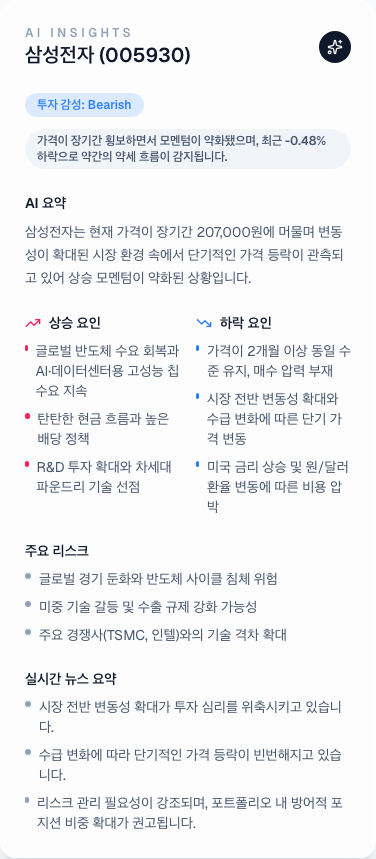

```json
{
  "schemaVersion": 1,
  "slug": "stock-ai-platform",
  "title": "주식 분석 플랫폼",
  "description": "국내·해외 주식 시세와 가격 이력, 종목 검색, 뉴스 기반 분석을 하나의 탐색 흐름으로 연결한 Next.js 대시보드입니다. KIS 시세 조회와 Groq 분석 요청을 서버에서 처리하고, 종목별 차트와 추천 근거를 함께 확인하도록 구성했습니다.",
  "stacks": ["Next.js", "React.js", "TypeScript", "TailwindCSS", "supabase"],
  "linkDemo": "https://stock.ycseng.com",
  "linkGithub": "https://github.com/side-projects-labs/stock-ai-platform"
}
```

# 주식 분석 플랫폼

## 목차

- [🧭 숫자에서 맥락으로 이어지는 탐색](#-%EC%88%AB%EC%9E%90%EC%97%90%EC%84%9C-%EB%A7%A5%EB%9D%BD%EC%9C%BC%EB%A1%9C-%EC%9D%B4%EC%96%B4%EC%A7%80%EB%8A%94-%ED%83%90%EC%83%89)
- [🗂️ 시장 목록에서 관심 종목까지](#%EF%B8%8F-%EC%8B%9C%EC%9E%A5-%EB%AA%A9%EB%A1%9D%EC%97%90%EC%84%9C-%EA%B4%80%EC%8B%AC-%EC%A2%85%EB%AA%A9%EA%B9%8C%EC%A7%80)
- [📈 가격 이력을 읽는 상세 차트](#-%EA%B0%80%EA%B2%A9-%EC%9D%B4%EB%A0%A5%EC%9D%84-%EC%9D%BD%EB%8A%94-%EC%83%81%EC%84%B8-%EC%B0%A8%ED%8A%B8)
- [📰 가격과 뉴스를 분석으로 연결하기](#-%EA%B0%80%EA%B2%A9%EA%B3%BC-%EB%89%B4%EC%8A%A4%EB%A5%BC-%EB%B6%84%EC%84%9D%EC%9C%BC%EB%A1%9C-%EC%97%B0%EA%B2%B0%ED%95%98%EA%B8%B0)
- [🛠️ 외부 서비스와 화면의 경계 나누기](#%EF%B8%8F-%EC%99%B8%EB%B6%80-%EC%84%9C%EB%B9%84%EC%8A%A4%EC%99%80-%ED%99%94%EB%A9%B4%EC%9D%98-%EA%B2%BD%EA%B3%84-%EB%82%98%EB%88%84%EA%B8%B0)
- [🌱 검증하며 확장할 탐색 흐름](#-%EA%B2%80%EC%A6%9D%ED%95%98%EB%A9%B0-%ED%99%95%EC%9E%A5%ED%95%A0-%ED%83%90%EC%83%89-%ED%9D%90%EB%A6%84)

가격과 등락률만으로는 종목을 파악하기 어렵습니다. 최근 주가 흐름과 관련 뉴스, 주목할 근거와 위험 요인도 함께 살펴봐야 합니다. 이 대시보드에서는 시세 목록에서 종목을 찾고, 검색과 차트를 거쳐 분석 내용까지 한곳에서 확인할 수 있습니다.

## 🧭 숫자에서 맥락으로 이어지는 탐색

국내와 해외 시장은 같은 화면 구성을 사용합니다. 거래가 활발한 종목은 순위 목록에서 찾고, 관심 있는 종목은 이름이나 티커로 검색합니다. 어느 목록에서든 가격과 등락률을 비교한 뒤 차트와 분석 화면으로 이동할 수 있습니다.

시세 조회, 뉴스 수집, 모델 호출은 서버에서 처리하고, 화면에서는 그 결과를 공통 종목 데이터로 받아 사용합니다. 가격 변화와 분석 내용을 함께 보여주면서도, 조회한 시세와 이를 해석한 내용이 뒤섞이지 않도록 처리 단계를 나눴습니다.

## 🗂️ 시장 목록에서 관심 종목까지

### 거래가 활발한 종목을 살펴보기

처음 접속하면 국내 주식 목록이 열립니다. 탭을 누르면 해외 시장으로 전환할 수 있고, 국내 목록은 거래량 또는 거래대금 기준으로 조회할 수 있습니다. 각 행에는 종목명·코드·현재 가격·등락률과 함께 분석 요청, 차트 이동 버튼을 배치했습니다.


_실제 배포 서비스에서 종목 목록 영역을 캡처했습니다. 같은 행에서 가격·등락률을 비교하고 상세 화면으로 이동할 수 있습니다. 화면에 보이는 수치는 촬영 시점의 조회 결과입니다._

시세 목록은 React Query로 조회하고 5분마다 갱신합니다. 조회 키에 시장과 순위 기준을 넣어 시장이나 정렬 조건이 다른 결과가 같은 캐시에 저장되지 않게 했습니다. 브라우저는 Next.js 내부 API를 호출하며, 증권 API 인증 정보와 시세 처리 로직은 서버에서 관리합니다.

### 이름과 티커로 탐색 범위 좁히기

검색어를 입력하면 해당 검색어가 담긴 URL로 이동해 결과를 조회합니다. 검색 화면에서도 기존 종목 목록 컴포넌트를 재사용하므로, 순위 목록에 없는 종목을 찾아도 가격을 확인하고 차트로 이동하는 방법은 같습니다.


_실제 검색 결과의 목록 영역입니다. 종목명과 코드를 함께 표시해 이름이 비슷한 종목을 구분합니다._

국내 종목 검색에는 KOSPI·KOSDAQ·KONEX 종목 마스터를 사용합니다. 파일을 내려받아 압축을 풀고 인코딩을 변환한 뒤 종목명과 코드를 읽습니다. 마스터 데이터는 일정 시간 캐시해 요청할 때마다 다시 내려받지 않도록 했습니다. 검색과 시세 조회는 서버 서비스에서 처리하고, 화면에는 공통 종목 타입에 맞춘 결과를 전달합니다.

## 📈 가격 이력을 읽는 상세 차트

목록에서 차트 보기를 누르면 종목 상세 페이지로 이동합니다. 주소에 담긴 종목 식별자로 데이터를 다시 조회해 종목명·가격·등락률과 차트를 보여줍니다. 가격은 국내 종목의 경우 원화, 해외 종목은 달러로 표시합니다.


_실제 종목 상세 화면을 캡처했습니다. 차트는 조회한 가격 이력을 바탕으로 구성한 시각화입니다._

차트는 Lightweight Charts로 그립니다. ResizeObserver로 화면 폭의 변화를 감지하고, 컴포넌트가 해제되면 관찰자와 차트 인스턴스를 함께 정리합니다. 종목 화면을 여러 번 오가도 이전 차트가 남지 않도록 했습니다.

현재 캔들은 가격 이력의 이전 값과 현재 값을 시가·종가로 삼고, 그 주변에 고가·저가 범위를 더해 그립니다. 따라서 거래소에서 받은 실제 OHLC 봉은 아니며, 가격 흐름을 살펴보기 위한 표현입니다. 색상은 국내 시세 화면의 관례에 맞춰 상승은 빨강, 하락은 파랑으로 정했습니다.

## 📰 가격과 뉴스를 분석으로 연결하기

### 분석에 사용할 입력을 모으기

종목을 분석할 때는 종목 코드와 현재 가격, 등락률, 가격 이력을 전달합니다. 서버는 여기에 종목 관련 뉴스 제목을 더해 Groq 모델에 보냅니다. 뉴스는 SerpAPI, Bing News, Yahoo Finance 순서로 조회하고, 사용할 결과가 없으면 기본 컨텍스트를 넣습니다.

분석 결과는 요약·상승 요인·하락 요인·모멘텀·리스크·뉴스 요약으로 나눕니다. 긴 글을 통째로 읽지 않아도 필요한 항목부터 확인할 수 있도록 했습니다. 뉴스 제공 서비스가 바뀌어도 분석 입력과 화면에서 사용하는 결과 타입은 유지합니다.



_실제 운영 서비스의 분석 결과입니다. 요약과 상승·하락 요인, 리스크와 뉴스 요약을 항목별로 확인합니다. 촬영 시점에 생성된 결과를 그대로 담았습니다._

### 응답을 기다리는 시간도 화면 상태로 다루기

분석 API는 모델의 응답을 텍스트 스트림으로 전달합니다. 화면에서는 받은 조각을 누적해 진행 상태를 보여주고, 수신이 끝나면 JSON으로 해석해 분석 패널에 표시합니다. 완성된 결과, 수신 중인 텍스트, 로딩·실패 상태는 각각 관리합니다.

분석 조회 키에는 종목 식별자와 함께 가격·등락률·이력 정보를 넣었습니다. 같은 종목이라도 입력한 가격 정보가 달라지면, 이전 분석 결과와 구분해 조회하도록 했습니다.

### 추천 후보를 먼저 좁히기

추천에는 화면에서 조회한 종목 중 일부를 사용합니다. 가격 이력의 모멘텀과 등락률로 정량 점수를 계산한 뒤, 상위 8개 후보에 뉴스 컨텍스트를 더합니다. 대시보드에서 요청하는 기본 추천 개수는 3개입니다.

모델이 반환한 종목 코드를 후보 목록과 대조해, 후보에 없는 종목은 제외합니다. 추천 행동은 buy·hold·avoid 중 하나로 정리하고, 점수는 0~100, 신뢰도는 0~1 범위로 보정합니다. 응답이 비어 있거나 해석에 실패하면 정량 점수에 따른 보수적인 대체 결과를 반환합니다. 다만 모델 요청 자체가 실패한 경우까지 대체하지는 않으므로, 이런 오류는 별도로 처리합니다.

## 🛠️ 외부 서비스와 화면의 경계 나누기

### 시세와 인증 처리는 서버에 모으기

KIS 연동에서는 시세·검색·상세 조회와 토큰 발급·보관을 별도 서비스로 나눴습니다. 브라우저는 내부 API만 호출하고, 증권 API 인증 정보와 모델·뉴스 서비스 키는 서버에서만 사용합니다.

토큰은 유효한 동안 재사용합니다. 같은 서버에서 갱신 요청이 겹치면 진행 중인 요청을 함께 기다립니다. Supabase가 설정된 환경에서는 토큰과 만료 시각을 저장하고, 갱신 락으로 여러 서버가 동시에 발급을 요청하는 상황을 조정합니다. Supabase 설정이 없으면 메모리 캐시를 사용합니다. 토큰 발급과 시세 조회를 나눠 각 경로를 따로 검증할 수 있게 했습니다.

### 데이터 계약과 상태 관리를 공유하기

Next.js App Router로 페이지와 서버 API를 구성하고, React·TypeScript로 화면을 구현했습니다. 시세·가격 이력·분석·추천 타입을 한곳에 정의해 API와 컴포넌트가 같은 필드를 사용하도록 했습니다. 클라이언트의 조회 상태는 TanStack Query로 관리하며, Tailwind CSS와 재사용 컴포넌트로 화면을 구성했습니다.

모델 이름과 뉴스·프롬프트 구성은 공유 서비스에서 관리합니다. 스트리밍 분석과 비스트리밍 분석, 추천, 가상 종목 생성이 모두 같은 모델 설정을 참조하므로, 모델을 교체할 때 일부 경로에 이전 모델이 남는 일을 줄일 수 있습니다.

### 외부 데이터의 의미 유지하기

국내·해외 시장을 지정한 시세 조회는 KIS 데이터를 사용하며, 조회에 실패하면 오류를 반환합니다. 시장을 지정하지 않았을 때 실행하는 가상 종목 생성 경로와는 별개입니다. 누락된 가격 이력을 보정한 값이나 뉴스 기본 컨텍스트도 실제로 관측한 데이터나 수집한 기사와 구분해 다룹니다.

가격과 분석 내용을 한 화면에 배치했지만, 분석과 추천은 종목 탐색을 돕는 정보로 다룹니다. 응답이 정해진 구조를 따르는지 검증하는 것과, 그 내용이 정확한지 보장하는 것은 별개의 문제입니다.

## 🌱 검증하며 확장할 탐색 흐름

Vitest와 React Testing Library로 시세 API, 토큰 발급·보관, 뉴스 수집, 분석 스트림과 화면의 주요 동작을 검증합니다. Playwright에서는 모의 API 응답으로 목록 조회와 분석 화면의 동작을 확인합니다. 외부 서비스가 실제로 연결되는지는 별도로 점검합니다.
